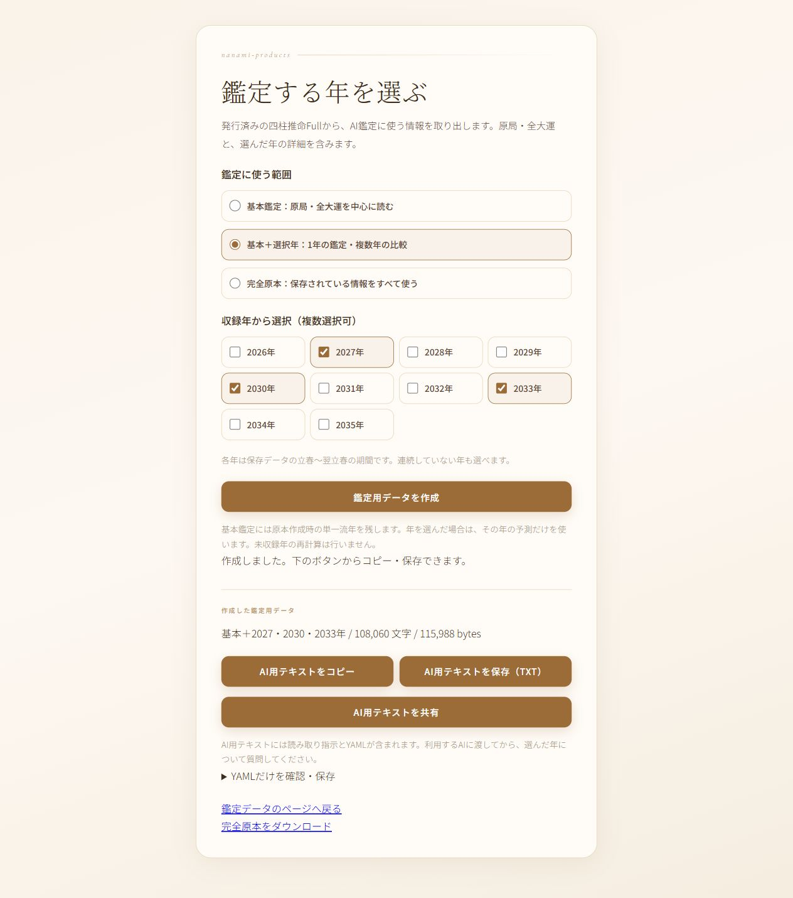

# 四柱推命Full：鑑定対象年の選択機能

2026-10-10。前回の比較・抽出報告を受け、「実装したい」という依頼で追加した機能。保存済みの基本Fullだけを対象に、AIへ渡す範囲を選べるようにした。新たな占術計算は追加していない。

## 利用方法

四柱推命の発行ページの「詳細データ・AI活用」にある「鑑定したい年を選んでYAMLを取り出す」から開く。

1. 基本鑑定、基本＋選択年、完全原本のいずれかを選ぶ。
2. 選択年の場合は収録年のチェックボックスで1年以上を選ぶ。連続していない年も選択できる。
3. 「鑑定用データを作成」を実行する。
4. 指示とYAMLを含むAI用テキストをコピー・TXT保存・共有する。YAMLだけの確認・コピー・保存もできる。

共有機能に対応しないブラウザではTXT保存に切り替える。外部AIへの自動送信は行わない。日本語・英語に対応。対象年は現在年から作らず、原本に保存された `effective_year` から読み取る。

## 保持する内容

基本鑑定は原局・全大運・原本の独立した構造分析や条件を保持し、原本作成時の単一流年も残す。選択年では同じ共通情報に選択された年の全項目を加え、原本作成時の単一流年は除外を明記する。刑冲合害・年別構造・複数大運・注意事項を要約して置き換えない。未選択年の予測は共通部分や互換コピーにも残さない。

完全原本は保存されたUTF-8テキストをそのまま返す。改行・末尾の空行も変えない。既存の原本URL・プロンプトURL・共有機能・ZIPを維持する。派生データは保存原本を上書きしない。

旧形式で年別予測がない場合は基本鑑定と完全原本を使える。未収録年、空選択、重複年、非整数、保存データの矛盾では抽出を止め、一部だけ成功した結果を返さない。期限切れ・不明なトークンは既存と同じ410・404になる。

## 出力構造

前回検証した `extract_base` とその照合・保持処理を再利用する。商品向けアダプターがラッパー名を `year_selection`、スキーマを `1.0` に変更し、対応するAI指示を付ける。通常の辞書・一覧で出力し、YAMLアンカーや表形式の試作は使わない。

保存済みの春の架空例から抽出した2027年のヘッダー抜粋（実際の出力には `common`、出典情報、全大運、選択年の分析全項目が含まれる）：

```yaml
year_selection:
  schema_version: '1.0'
  purpose: base_with_selected_years
  included_years: [2027]
  source_kind: issued_shichusuimei_full
  original_full_required_for_app_import: true
selected_base_forecasts:
  - effective_year: 2027
    kanshi: 丁未
    period_start: '2027-02-04T10:46:19.211426+09:00'
    period_end: '2028-02-04T16:31:14.816895+09:00'
```

この例のYAMLは103,246バイト・96,158文字。前回のローカル版からラッパー名・商品用途の情報だけを調整している。原局・大運・選択年の計算値は保存値のまま。単純個数から吉凶を決めない指示も含める。元のforecast metadataは元の収録範囲、`included_years`は今回の選択範囲として区別する。

派生YAMLはAI鑑定用。既存アプリへ再入力する互換商品YAMLとしては扱わず、機械連携には完全原本を使う。原本SHA-256は対応関係の追跡用であり、購入権限の証明ではない。

## APIとアクセス

- `GET /chart/{token}/year-selection`：選択画面。原本や氏名・出生情報を初期HTMLに埋め込まない。
- `POST /chart/{token}/year-selection`：JSON `{"mode":"selected","years":[2027,2030,2033]}` 等から抽出。
- `mode`は `basic`・`selected`・`complete`。基本・完全では `years` を省略または空配列にする。
- 成功時はYAML、対応プロンプト、AI用テキスト、対象年、文字数・UTF-8バイト数、保存用ファイル名を返す。
- 入力・保存データの不整合は422。原本・出生情報・例外内部のパスをエラーメッセージやログに出力しない。

既存の `_load_chart_or_404`、商品種別判定、トークン・有効期限チェックを再利用する。四柱推命の基本商品に限る。原本取得は既存ストアの読み取りのみで、外部URL取得・新規購入権限・DB更新は追加しない。画面と抽出応答は `no-store`、`noindex, nofollow`。端末のlocalStorageへデータを保存しない。

## 変更したファイル

| ファイル | 今回の変更 |
|---|---|
| `routes.py` | 新しいGET・POSTと、商品種別を確認するヘルパー・アダプターのimportのみ |
| `templates/chart_page.html` | 四柱推命の詳細欄にリンクを追加（3行） |
| `services/shichusuimei_year_selection.py` | 保存データ抽出のアダプター・入力確認・商品向けラッパー・対応指示 |
| `templates/shichusuimei_year_selection.html` | 選択・結果画面、日本語・英語、既存CSSに合わせた表示 |
| `static/shichusuimei_year_selection.js` | コピー・保存・共有、選択変更時の結果無効化、古い応答の抑止 |
| `tests/test_shichusuimei_year_selection.py` | 自己完結した架空fixtureによるサービス・API・表示・アクセスの31テスト |
| `tests/test_shichusuimei_year_selection_ui.cjs` | 非同期の応答順序・コピー・保存など6テスト（Node標準モジュールのみ） |
| `docs/shichusuimei_year_selection_implementation.md` | この報告 |
| `docs/images/shichusuimei_year_selection.jpg` | 架空データでの完成画面 |

既存の抽出・比較・圧縮試作、計算エンジン、Full生成処理は今回編集していない。試作モジュールの保存データ抽出関数をアダプター経由で利用するので、これらも今後のコミットに含めて管理する必要がある。

## 検証結果

- Pythonの新規31件と関連回帰をまとめて **200件＋2 subtests合格**（67.12秒）。既存の四柱推命構造・立春/交運・年別分析、前回の抽出、Full試作、共有・期限・ZIPを含む。
- 新画面のチェック表示調整後も商品テスト31件が再度合格。
- NodeのUIテスト **6件合格**。表示中のYAML/対応指示とコピー・保存内容の一致、選択変更後の旧データ消去、応答逆転時の上書き防止、エラー後の結果無効化を確認。
- ブラウザでは保存済み架空例の2027・2030・2033年の抽出、空選択の案内、選択変更による結果消去、完成画面を確認。共有先の実AIアプリ・実スマートフォンへのファイル受け渡しは未検証。IABのクリップボード読み取りでは内容を取得できず、ネイティブのクリップボード実体の一致は未確認（JSテストで渡す内容は照合済み）。
- 検証サーバーは127.0.0.1のみで、DB取得を架空fixtureへ置換し、lifespanを無効にして使用。実DBや外部AIへ接続していない。
- 作業開始時の2,878ファイルのうち、今回変更する `routes.py`・`templates/chart_page.html` を除く **2,876ファイルは全ハッシュ一致**。欠落なし。保存済み原本・前回試作も一致。
- `git diff --check`合格。既存FastAPI・Starlette・httpxの非推奨警告は残る。

Windowsの制限環境ではasyncioのローカルsocketpair生成が止まるため、APIテストと確認サーバーを制限外で実行した。アプリの修正による停止ではない。

再実行例：

```powershell
.venv\Scripts\python.exe -m pytest tests/test_shichusuimei_year_selection.py tests/test_shichusuimei_year_extract_prototype.py tests/test_shichusuimei_full_prototype.py tests/test_shichusuimei_annual_prototype.py tests/test_chart_yaml_copy.py tests/test_chart_expiry.py tests/test_chart_download_zip.py tests/test_shichusuimei_full_routes_audit.py tests/test_shichusuimei_structure.py tests/test_shichusuimei_timing_regressions.py tests/test_shichusuimei_annual_report.py -q -p no:cacheprovider --basetemp=tmp/year_selection_impl/acceptance
node --test tests/test_shichusuimei_year_selection_ui.cjs
```

## 範囲と今後

基本商品に既存収録されている情報をそのまま選ぶ機能まで実装した。流年オプションの年数・価格・販売、URL/YAMLによる別商品の連携、未収録期間の追加計算、月運は今回追加していない。同じ年の基本予測と追加試作を上位互換と決めつけたり、自動統合したりもしない。

次の候補は実端末でのTXT共有確認と、商品条件を決めた後の追加期間の連携。今回はコミット・push・本番デプロイ・本番DB操作を行わず、既存の未コミット変更にこの差分を追加した状態で完了する。


